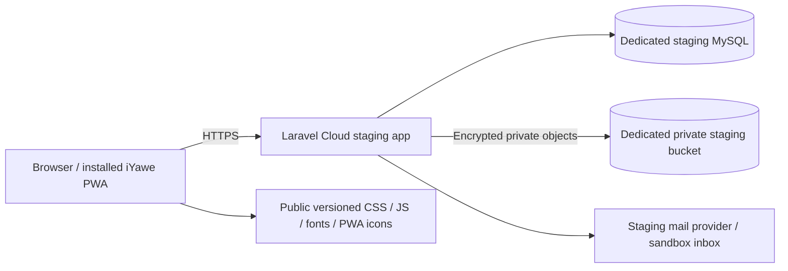

# Milestone 4 — staging readiness and acceptance report

Date: 18 October 2026. This report distinguishes local automated acceptance from live staging and physical-device acceptance.

**Implemented and locally verified; not deployed to Laravel Cloud or production.** No Cloud account/session, application/environment identifier, provisioned staging resources, bucket credentials, staging URL or real-device access was supplied. The repository remote is https://github.com/Akuzwe-G/iYawe.git; the current local branch is main. Nothing was pushed.

## Implementation summary

- Signatures and PDFs now use IYAWE_DOCUMENTS_DISK through PrivateDocuments instead of a hard-coded local disk. Local development stays compatible. Staging/production document access rejects local/public storage; cloud environments require a private S3-compatible disk.
- Installed the approved league/flysystem-aws-s3-v3 adapter (3.35.3). Existing Laravel Crypt ciphertext, paths and SHA-256 formats are unchanged. Existing encrypted branding remains in MySQL.
- Added a source-preserving, hash-verified document copy command, explicit staging readiness checks, repeatable Composer staging build/deploy scripts, a secret-free environment template and restricted acceptance fixtures.
- The exact supplied Kinyarwanda template is now marked formally approved by the product owner. No declaration or receipt wording changed. Company publication is still authorised, versioned and audited; replacing an existing active declaration requires explicit authorisation.
- Added publication evidence hashes/source/approval metadata, HTTPS/security headers, private response caching headers and writable PDF font/temp directories.
- Extended PHPUnit acceptance for both languages, all card reasons, analytics/date boundaries, private storage/copy integrity, consent replacement, secure cookies, sessions, CSRF and XSS/CSV protections. Added live local browser journeys and service-worker update/cache checks.

## Staging architecture



Only authorised Laravel endpoints return decrypted signatures or PDFs. The browser is not given object-storage URLs. Customer data is never an offline transaction store. Use a separate staging database, bucket and encryption key; do not import production/local customer records into staging.

Laravel Cloud supports build/deploy commands in the environment's deployment settings. Builds preserve generated files; deploy-command filesystem changes do not persist. Optimisation belongs in the build stage. These are platform capabilities, not a claimed deployment. Sources: [Cloud environment build/deploy documentation](https://laravel.com/cloud/docs/environments), [Cloud deployments](https://laravel.com/cloud/docs/deployments).

## Runtime and environment configuration

Locally verified: Laravel 13.37.0, PHP 8.3.33, Node 22.23.2, npm 10.9.8, Dompdf 3.1.2, Spatie Permission 8.3.0. Composer platform checks passed. GD is also required for signature/logo validation and PWA icon generation; the staging guard checks it. Enable required extensions in the Cloud runtime before building. Select a supported PHP version compatible with the lock file (8.3 matches this test environment); verify the Cloud build's Node version satisfies package.json (>=22.12). [Cloud runtime documentation](https://laravel.com/cloud/docs/runtimes).

Use .env.staging.example as a reference, **not as a file to upload with blank resource values**. Cloud-injected database/object-storage credentials must not be replaced by blank custom variables. Enter real secrets through Cloud environment settings/secrets. There are no secret values in the template.

| Variable | Staging value / handling |
| --- | --- |
| APP_ENV / APP_DEBUG | staging / false |
| APP_URL | Actual HTTPS staging origin, once Cloud provides it; currently unknown |
| APP_KEY | Stable environment-specific key; retain Cloud's initial key and back it up securely |
| DB_CONNECTION | mysql |
| DB_HOST, DB_PORT, DB_DATABASE, DB_USERNAME, DB_PASSWORD / DB_URL | Dedicated attached staging database's injected values; never production |
| SESSION_DRIVER / SESSION_ENCRYPT | database / true |
| SESSION_SECURE_COOKIE / SESSION_HTTP_ONLY / SESSION_SAME_SITE | true / true / lax |
| SESSION_COOKIE / SESSION_DOMAIN | iyawe_staging_session / null (host-only) |
| CACHE_STORE / CACHE_PREFIX | database / iyawe_staging_cache |
| QUEUE_CONNECTION | sync initially; database only with a configured Cloud worker |
| FILESYSTEM_DISK / IYAWE_DOCUMENTS_DISK | s3 / s3; attach the private bucket with disk name s3 |
| AWS_ACCESS_KEY_ID / AWS_SECRET_ACCESS_KEY / AWS_BUCKET | Attached private staging bucket's injected values |
| AWS_ENDPOINT / AWS_ENDPOINT_URL | Actual injected S3-compatible endpoint; config supports either spelling |
| AWS_DEFAULT_REGION / AWS_REGION | Actual injected region, with auto fallback for R2 |
| AWS_URL | Unset for the private document disk |
| AWS_USE_PATH_STYLE_ENDPOINT | Use the attached provider's required setting; default false |
| MAIL_MAILER and provider settings | Real staging transport (e.g. smtp) and a sandbox/test inbox |
| MAIL_FROM_ADDRESS / MAIL_FROM_NAME | Verified staging sender / iYawe |
| LOG_CHANNEL / LOG_LEVEL | stderr / warning |
| IYAWE_TRUSTED_PROXIES | Leave empty for normal Cloud hosting; reviewed IP/CIDR list only for a custom proxy |
| IYAWE_SYSTEM_ADMIN_NAME / EMAIL / PASSWORD | Bootstrap secrets once, then remove the credentials after successful seeding |

Never run key:generate on every deployment. Never use composer run setup on staging: that existing local-development script generates a key. Preserve APP_KEY across releases and restores; losing it also breaks encrypted database fields and blind-search fingerprints.

Laravel's installed TrustProxies implementation already recognises Laravel Cloud. Application code adds only an optional reviewed proxy list; it does not globally trust arbitrary custom networks. Verify HTTPS URL generation and cookie flags on the actual Cloud origin before acceptance. [Framework proxy implementation](https://github.com/laravel/framework/blob/13.x/src/Illuminate/Http/Middleware/TrustProxies.php).

## Database, migration and permission seeding

Added 2026_10_18_122221_add_publication_evidence_to_consent_versions.php, a nullable JSON evidence column. Existing signed declarations and existing data are not rewritten. Applied safely to the local application and isolated test databases.

RolesAndPermissionsSeeder is idempotent and preserves custom roles and their permissions (automated tests verify this). It adds approved permission catalogue entries and provisions reserved default roles. Staging deployment does not run AcceptanceSeeder or destructive seeders.

The default health endpoint is /up. It checks application boot, not all external dependencies. Use the explicit readiness probes below for database/storage checks.

## Private persistent storage and safe migration

Create a **Private** Laravel Cloud Object Storage bucket dedicated to staging and attach it as disk s3. Bucket privacy must be verified in Cloud; a disk label alone cannot prove bucket visibility. Do not set a public URL or public object visibility. Cloud Object Storage is S3-compatible and requires the installed adapter. [Official object-storage instructions](https://laravel.com/cloud/docs/resources/object-storage).

Local serve=true file routes were disabled. Signatures/PDFs remain encrypted and are read only after active membership, tenant and permission checks. Reads decrypt and verify SHA-256; missing archived documents return 410, corruption returns an error, and a missing immutable PDF is not silently regenerated. No public/storage link is used.

For an existing **same-environment** migration, on the original host with the original APP_KEY and access to both private disks:

```sh
php artisan iyawe:documents-copy --from=local --to=s3
php artisan iyawe:documents-copy --from=local --to=s3 --write
```

The first command validates referenced source objects without writing. The second validates plaintext hashes, copies the existing ciphertext byte-for-byte, verifies the destination and retains all sources. It includes historical signatures and PDFs referenced by soft-deleted records. Existing differing destination objects cause failure instead of overwrite. A partial run is resumable; stop and investigate missing/corrupt sources or conflicts. Unreferenced orphan files are not copied.

Coordinate a write pause, back up database/private files/key, verify the full copy, then change IYAWE_DOCUMENTS_DISK and deploy. Recheck authorised downloads after another redeploy. Keep sources until retention/restore acceptance is complete. This command does not change disk configuration, delete originals or migrate encryption formats. **Do not use it to import real customer data into staging.** No live customer files were copied during this milestone.

PDF font caches and temporary files use private writable storage directories created at boot. They can be ephemeral; original Montserrat TTFs are deployed from resources/fonts. Generated encrypted PDFs/signatures must use persistent object storage.

## Exact Laravel Cloud staging steps

1. Review and commit these changes to the connected repository, then push an approved staging branch. Do not connect a production branch/environment by mistake.
2. In Laravel Cloud, connect the GitHub repository and create/select a separate environment named staging, pointing to that branch. Use the dashboard to choose compute and a supported PHP runtime.
3. Attach a new dedicated MySQL database and a new **Private** object-storage bucket as the default s3 disk. Do not reuse production resources. Review any costs before provisioning.
4. Configure the non-secret settings above and actual secret values. Preserve the environment's key. Review Cloud's injected variables: if APP_URL already contains the correct HTTPS origin, retain it; otherwise use the actual domain shown/configured in Cloud. If that origin is not yet available, obtain it from the dashboard or configure a verified custom staging domain before the guarded deployment. Do not bypass the guard with a guessed host. Redeploy after settings changes.
5. Configure these build commands in Settings → Deployments:

```sh
composer install --no-dev --prefer-dist --no-interaction --optimize-autoloader
composer run staging:build
```

staging:build runs npm ci --ignore-scripts, npm run build (which includes iyawe:pwa-build), then php artisan optimize. It makes no database changes.

6. Configure the deploy command:

```sh
composer run staging:deploy
```

This runs the staging configuration guard, migrate --force, RolesAndPermissionsSeeder, then database and synthetic encrypted object-storage probes. A failed guard/probe returns non-zero. No destructive reset, key generation, storage symlink or broad cache-clear command is included.

7. Deploy from the Cloud dashboard and inspect build/deploy logs. Verify /up, secure cookie flags, actual HTTPS links, the manifest and service worker. Ensure the worker is JavaScript, the manifest has a suitable manifest/JSON MIME type, and the worker/manifest are revalidated rather than indefinitely cached. Registration uses updateViaCache=none; versioned static assets may be cached.
8. In Cloud's command interface, bootstrap the staging administrator once:

```sh
php artisan db:seed --class=SystemAdminSeeder --force --no-interaction
```

Use temporary strong credentials supplied through environment secrets, then remove those bootstrap credentials. Never put a password in a command argument, repository or report.
9. Complete the acceptance checklist below using fictional companies/staff/customers created through the staging interface. Configure real/sandbox mail delivery and verify an actual reset message.
10. Redeploy once more and verify the same saved signatures and immutable PDFs still download and hash-check. Record the staging URL, deployment identifier and observations in this report.

Do not put optimize, storage:link or filesystem copy work in Cloud deploy commands. Optimisation is already in the build step; object migration must run where source files actually exist. Cloud manages release worker restarts. On failure, keep the previous release, inspect logs and fix the cause; do not run migrate:fresh, reset data or regenerate a key. Additive migrations are compatible with the previous model, but review rollback compatibility before changing storage configuration.

The selected synchronous queue needs no worker. If database queues are enabled later, add a Cloud queue worker and verify delivery. No new scheduled task was added.

## Approved Kinyarwanda publication

The product owner formally approved the supplied Kinyarwanda text in the Milestone 4 instruction on 18 October 2026. config/consent.php retains the same six points and separate receipt, with template approval evidence added. Earlier pending-approval notes in MILESTONE3.md describe the previous milestone.

Authorised company personnel use Consent versions, choose Kinyarwanda, confirm applicability and publish. They must explicitly authorise replacement if another declaration is active. CLI equivalent for a fresh company:

```sh
php artisan iyawe:consent-publish COMPANY_SLUG rw --approved-by=AUTHORISED_MEMBER_EMAIL
```

--replace-current is an explicit replacement request; it is never added by deployment seeding. Historical version identifiers cannot be reused with different wording, and an inactive historical version cannot silently be reactivated. Use a fresh version identifier in the company UI when needed. Identical active publication is idempotent.

Each new publication retains approver ID/time, source, wording/receipt hashes, explicit replacement intent and template approval evidence when applicable. CLI audit logs now attribute the approving member rather than a null actor. No existing company declaration was automatically replaced. Only isolated fictional test companies were published during acceptance.

## Security findings and fixes

| Finding | Resolution and evidence |
| --- | --- |
| Document operations hard-coded to local storage | Configurable private disk; staging/production reject local disks; fake-disk workflow and ciphertext-copy tests pass |
| Local disk had serve=true | Disabled direct local file serving; private Laravel endpoints retained |
| Missing/corrupt signatures could produce low-level retrieval errors | Shared read/decrypt/hash verification with controlled missing/integrity errors |
| CLI publication could supersede a custom active company declaration | Shared publisher requires explicit replacement, locks the company and preserves immutable versions |
| CLI audit actor was null | Approver is recorded explicitly; evidence hashes/source stored |
| Kinyarwanda still labelled pending | Approved template metadata and company publication UI updated without changing wording |
| Cloud font cache/writable path assumptions | Private font/temp directories created at boot; PDFs embed Montserrat (FontFile2 assertion) |
| Authentication/privacy response hardening | HTTPS HSTS, no-sniff, frame denial, same-origin referrer policy, restricted permissions and no-store private responses |
| Acceptance tests could target an ordinary MySQL database | Test bootstrap refuses database-refresh tests unless its database begins iyawe_m4_test_; fixture seeder also requires testing environment |
| Three smoke tests assumed auto-increment ID 1 | MySQL exposed the assumption; tests now resolve the actual company consent version, preserving all assertions |
| Risk of secret-bearing deployment logs | No new request-body logging; stderr warning profile and secret-free command output; live provider log review still required |

Existing tenant policies, validated input allowlists, reserved roles, CSRF, escaped Blade output, SQL bindings, raster-logo decoding, private ciphertext and PWA allowlisting were exercised. This is an application review and acceptance programme, not an independent penetration-test certification.

## Automated execution and environment

Local PHPUnit runs use isolated SQLite memory databases and a separate local MySQL database named iyawe_m4_test_suite. Fictional live-browser records use that dedicated database after the suite completes, with separate encrypted test storage and a separate test key. No production customer information was used. The original application environment file was not replaced.

Final counts and per-test rows are appended below from the actual JUnit/JSON artifacts. Reports are under storage/app/milestone4-*.json and *.xml; browser PDFs/screenshots are under storage/app/milestone4-browser/. Test fixture/key files are private and ignored by Git.

To rerun PHPUnit locally:

```powershell
php artisan config:clear
php artisan test --compact --log-junit storage/app/milestone4-sqlite.xml
# In a separate shell, only after creating a dedicated local test database:
$env:DB_CONNECTION='mysql'
$env:DB_DATABASE='iyawe_m4_test_suite'
$env:DB_URL=''
php artisan test --compact --log-junit storage/app/milestone4-mysql.xml
```

Use a test-only database account and never point these commands at staging/production business data. The safety prefix is an additional guard, not a substitute for checking host/account. Do not run configuration caching or database-refresh tests concurrently with a live browser run. Framework optimisation was tested separately and local configuration/route caches were cleared afterwards.

Browser runners are tests/Browser/milestone4.mjs and tests/Browser/pwa-cache.mjs. They use optional Playwright tooling and an installed Microsoft Edge (Playwright is intentionally not a project dependency), use loopback ports 8795/8793 and stop their own servers. The live runner requires the isolated MySQL schema and acceptance fixture seeder. A clean npm ci removes temporary browser tooling. To opt into rerunning these checks on a development/test machine, install Playwright temporarily with npm install --no-save --package-lock=false playwright, then run node tests/Browser/milestone4.mjs and node tests/Browser/pwa-cache.mjs. This is not part of the Cloud application build. Its password/key are generated privately; it refuses a database name outside the test prefix. It exercises real HTTP routes, CSRF/session middleware and server persistence. Touch gestures are Chromium emulation, not physical Android/iPhone or Safari certification.

## Manual staging and physical-device acceptance checklist

Status vocabulary: Passed / Failed / Blocked / Not Run. Leave observations with tester, device/browser, staging deployment and date.

| Acceptance item / procedure | Current result | Acceptance status | Observations |
| --- | --- | --- | --- |
| Provision separate Cloud staging app/database/private bucket; record URL and deployment ID | Blocked — no Cloud account/resources supplied | _____ | _____ |
| Build/deploy scripts finish, /up returns 200, correct branch/version | Blocked — requires Cloud deployment | _____ | _____ |
| HTTPS certificate, redirects, generated links, secure/HTTP-only/SameSite cookies | Blocked — actual HTTPS origin unavailable | _____ | _____ |
| MySQL staging connection and migrated schema | Blocked — local MySQL passed; Cloud resource unavailable | _____ | _____ |
| Object-storage canary succeeds and bucket denies unauthorised public access | Blocked — live bucket unavailable | _____ | _____ |
| Save signatures/PDF, redeploy, download identical originals | Blocked — requires live redeployment | _____ | _____ |
| System Administrator login, company creation and initial Company Administrator | Not Run on Cloud — local automated coverage passed | _____ | _____ |
| Company branding logo/legal name/contact/header/footer and no-logo fallback | Not Run on Cloud — local coverage passed | _____ | _____ |
| Staff, custom roles, permission assignment, membership switching/suspension | Not Run on Cloud — local automated coverage passed | _____ | _____ |
| Approve/publish EN/RW for fictional company; preserve custom existing version | Not Run on Cloud — local publication coverage passed | _____ | _____ |
| Complete English swap and all three signatures | Not Run on Cloud — local browser journey passed | _____ | _____ |
| Complete Kinyarwanda swap with independent customer language and three signatures | Not Run on Cloud — local browser journey passed | _____ | _____ |
| Visual PDF review: exact version/wording, all six points, receipt, logo, values, signatures, glyphs, pagination | Not Run — generated files available for manual review | _____ | _____ |
| Print each language PDF and report to paper / device print dialog | Not Run — requires human print acceptance | _____ | _____ |
| Exact record search, masked summaries, company reports and filters | Not Run on Cloud — local automated coverage passed | _____ | _____ |
| Verify KPIs and charts against staging fictional records, all date ranges and role dashboards | Not Run on Cloud — local MySQL aggregate tests passed | _____ | _____ |
| Draft autosave/manual save, refresh/recovery, conflict and network interruption | Not Run on Cloud — local server/browser checks passed | _____ | _____ |
| Company B altered-ID attempts against Company A records/PDF/signature/report/branding | Not Run on Cloud — local isolation tests passed | _____ | _____ |
| Actual password-reset message and reset link delivery to test inbox | Blocked — staging mail credentials/inbox unavailable | _____ | _____ |
| Android Chrome: install, standalone launch/login/logout/navigation, portrait/landscape touch signing, clear/retry, reconnect | Not Run — physical Android required | _____ | _____ |
| iPhone Safari: Share → Add to Home Screen; standalone login/logout, safe areas, touch, rotate, clear/retry, staff unlock | Not Run — physical iPhone required | _____ | _____ |
| Installed app update prompts safely, offline page is bilingual, private data absent after logout/relaunch | Not Run on phones — local service-worker/cache tests passed | _____ | _____ |
| Review Cloud logs for secrets/PII; test encrypted backups and restore with retained key | Not Run — requires live resources and backup access | _____ | _____ |

## Known limitations and production-readiness blockers

No Cloud deployment, real SMTP delivery, live S3/R2 bucket round trip or cross-redeployment persistence was performed. Local fake disks prove application behaviour, not a provider's bucket policy. Actual staging configuration checks cannot pass on the deliberately local development profile; the guard correctly rejects it.

Browser tests used headless Edge with mouse and emulated touch/phone sizes. Physical Android/iPhone installation, actual Safari rendering, OS session behaviour and paper printing remain unverified. Do not treat browser emulation as physical-device sign-off.

Visual/legal PDF review and native-speaker UI review remain human acceptance items even though exact stored declarations, fonts and workflows were automated. No automatic draft retention purge or key-rotation migration was added. No independent penetration test was performed.

Production remains out of scope. Before considering production: provision and accept staging, verify live bucket privacy and redeploy persistence, test real mail and backups, complete phone/print acceptance, review deployment logs and obtain product-owner/security sign-off. Do not regenerate the existing environment key or reuse production data/resources in staging.

## Source changes

New: PrivateDocuments, ConsentPublisher, CopyPrivateDocuments, StagingCheck, SecurityHeaders, publication-evidence migration, AcceptanceSeeder, .env.staging.example, StagingAcceptanceTest, AnalyticsAcceptanceTest and tests/Browser runners.

Updated: document services/controller, consent controller/command/model/config/view, AppServiceProvider, bootstrap/app.php, filesystem/iyawe configuration, translations, Composer dependencies/scripts, Node engine declaration, smoke test ID resolution and test database guard. Generated PWA/build assets were rebuilt with Montserrat and the existing iYawe colours. A clean npm ci succeeded; the first sandboxed clean build could not fetch Bunny Fonts, and the approved network-enabled retry passed. Font downloading is a build-time requirement; the resulting runtime fonts are hosted locally.


## Recorded automated results

| Programme / environment | Result | Evidence |
| --- | --- | --- |
| PHPUnit / SQLite memory | 61/61 Passed; 702 assertions | milestone4-sqlite.json and JUnit XML |
| PHPUnit / isolated local MySQL | 61/61 Passed; 702 assertions | milestone4-mysql.json and JUnit XML |
| Browser / local MySQL + headless Edge | 11 named checks Passed; no page errors | milestone4-browser/results.json |
| PWA cache/update/offline fixture / Edge | Passed; 16 static assets; zero private URLs; old cache cleanup verified | milestone4-pwa-review.json |
| Clean npm ci / Vite production build + PWA generation | Passed; network-enabled font fetch required | milestone4-clean-build.txt |
| Laravel optimise / routes / Blade | Passed locally, caches cleared after verification | milestone4-optimize.txt; milestone4-routes.txt |
| Composer validation / platform requirements | Passed | CLI checks |
| Live Cloud deployment / bucket persistence / SMTP | Blocked | Resources/credentials unavailable |
| Real Android / iPhone / printing | Not Run | Physical acceptance checklist above |

### PHPUnit case-level results

Each row records both isolated local environments. A dash means no remaining failure.

| Test name | SQLite | MySQL | Failure details / fix |
| --- | --- | --- | --- |
| Tests\Unit\ExampleTest::test_that_true_is_true | Passed | Passed | — |
| Tests\Feature\AdditionalSecurityTest::test_password_recovery_is_hidden_and_blocked_without_delivery | Passed | Passed | — |
| Tests\Feature\AdditionalSecurityTest::test_multiple_companies_require_explicit_selection_and_reject_untrusted_context | Passed | Passed | — |
| Tests\Feature\AdditionalSecurityTest::test_revoking_roles_in_one_company_preserves_other_company_roles | Passed | Passed | — |
| Tests\Feature\AdditionalSecurityTest::test_new_staff_membership_can_be_created_inactive | Passed | Passed | — |
| Tests\Feature\AdditionalSecurityTest::test_shared_account_identity_and_password_cannot_be_overwritten_by_company_admin | Passed | Passed | — |
| Tests\Feature\AdditionalSecurityTest::test_only_platform_administrators_can_manage_platform_preferences | Passed | Passed | — |
| Tests\Feature\AnalyticsAcceptanceTest::test_all_dashboard_periods_and_chart_groupings_match_isolated_records | Passed | Passed | — |
| Tests\Feature\AnalyticsAcceptanceTest::test_empty_dashboard_has_no_fabricated_activity_and_report_filters_remain_scoped | Passed | Passed | — |
| Tests\Feature\AuthenticationTest::test_login_screen_and_public_registration_disabled | Passed | Passed | — |
| Tests\Feature\AuthenticationTest::test_successful_login_and_logout | Passed | Passed | — |
| Tests\Feature\AuthenticationTest::test_failed_and_disabled_login | Passed | Passed | — |
| Tests\Feature\AuthenticationTest::test_login_is_rate_limited | Passed | Passed | — |
| Tests\Feature\AuthenticationTest::test_disabled_account_loses_existing_session | Passed | Passed | — |
| Tests\Feature\AuthenticationTest::test_password_reset_notification_and_token | Passed | Passed | — |
| Tests\Feature\AuthenticationTest::test_language_switch_persists_for_guests_and_users | Passed | Passed | — |
| Tests\Feature\ExampleTest::test_home_redirects_to_the_unified_login | Passed | Passed | — |
| Tests\Feature\FoundationTest::test_system_administrator_can_create_edit_and_suspend_company | Passed | Passed | — |
| Tests\Feature\FoundationTest::test_initial_company_administrator_assignment | Passed | Passed | — |
| Tests\Feature\FoundationTest::test_company_administrator_can_create_staff_and_scoped_role_assignment | Passed | Passed | — |
| Tests\Feature\FoundationTest::test_custom_roles_and_locations_and_settings_work | Passed | Passed | — |
| Tests\Feature\FoundationTest::test_first_administrator_command_uses_hidden_password_and_refuses_existing_account | Passed | Passed | — |
| Tests\Feature\InterfaceTest::test_login_uses_local_montserrat_assets_and_responsive_layout | Passed | Passed | — |
| Tests\Feature\InterfaceTest::test_company_screens_render_in_kinyarwanda | Passed | Passed | — |
| Tests\Feature\KinyarwandaConsentTest::test_supplied_kinyarwanda_consent_can_be_published_and_used_with_english_interface | Passed | Passed | — |
| Tests\Feature\Milestone3Test::test_partial_drafts_are_revision_checked_tenant_scoped_and_discarded_with_retention | Passed | Passed | — |
| Tests\Feature\Milestone3Test::test_branding_is_validated_encrypted_and_applied_to_scoped_reports | Passed | Passed | — |
| Tests\Feature\Milestone3Test::test_company_members_require_branding_permission | Passed | Passed | — |
| Tests\Feature\Milestone3Test::test_customer_handoff_protects_staff_navigation_and_requires_password | Passed | Passed | — |
| Tests\Feature\Milestone3Test::test_historical_branding_does_not_follow_later_company_changes | Passed | Passed | — |
| Tests\Feature\StagingAcceptanceTest::test_approved_template_publication_is_authorised_audited_idempotent_and_preserves_custom_versions | Passed | Passed | — |
| Tests\Feature\StagingAcceptanceTest::test_both_languages_complete_all_steps_on_configured_private_storage_and_preserve_pdfs | Passed | Passed | — |
| Tests\Feature\StagingAcceptanceTest::test_copy_is_dry_by_default_retains_sources_and_refuses_destination_conflicts | Passed | Passed | — |
| Tests\Feature\StagingAcceptanceTest::test_unsafe_document_disks_and_cloud_local_storage_are_rejected | Passed | Passed | — |
| Tests\Feature\StagingAcceptanceTest::test_https_cookie_flags_session_regeneration_and_expired_session_denial | Passed | Passed | — |
| Tests\Feature\StagingAcceptanceTest::test_csrf_is_enforced_when_the_framework_test_bypass_is_disabled | Passed | Passed | — |
| Tests\Feature\StagingAcceptanceTest::test_company_branding_xss_is_escaped_and_csv_formula_is_neutralised | Passed | Passed | — |
| Tests\Feature\StagingAcceptanceTest::test_staging_readiness_fails_closed_on_local_configuration_without_secrets | Passed | Passed | — |
| Tests\Feature\StagingAcceptanceTest::test_all_card_reasons_and_balance_validation_preserve_string_identifiers | Passed | Passed | — |
| Tests\Feature\StagingAcceptanceTest::test_safe_staging_configuration_passes_without_claiming_live_resource_probes | Passed | Passed | — |
| Tests\Feature\StagingAcceptanceTest::test_database_session_handler_rejects_expired_payloads | Passed | Passed | — |
| Tests\Feature\SwapWorkflowSmokeTest::test_completed_workflow_private_files_pdf_reports_and_dashboards | Passed | Passed | Earlier MySQL ID=1 assumption fixed by resolving the published version. |
| Tests\Feature\SwapWorkflowSmokeTest::test_no_receipt_before_physical_completion_and_no_cross_company_access | Passed | Passed | Earlier MySQL ID=1 assumption fixed by resolving the published version. |
| Tests\Feature\SwapWorkflowSmokeTest::test_unapproved_consent_and_blank_signature_are_blocked | Passed | Passed | Earlier MySQL ID=1 assumption fixed by resolving the published version. |
| Tests\Feature\SystemAdminSeederTest::test_seeded_system_administrator_can_sign_in_and_create_companies | Passed | Passed | — |
| Tests\Feature\SystemAdminSeederTest::test_reseeding_preserves_existing_administrator_credentials_and_account_status | Passed | Passed | — |
| Tests\Feature\SystemAdminSeederTest::test_existing_staff_account_is_not_promoted_or_overwritten | Passed | Passed | — |
| Tests\Feature\SystemAdminSeederTest::test_missing_credentials_skip_bootstrap_without_creating_demo_accounts | Passed | Passed | — |
| Tests\Feature\SystemAdminSeederTest::test_incomplete_or_weak_credentials_are_rejected_without_secret_disclosure | Passed | Passed | — |
| Tests\Feature\SystemAdminSeederTest::test_invalid_email_is_rejected | Passed | Passed | — |
| Tests\Feature\SystemAdminSeederTest::test_roles_seeder_is_idempotent_and_preserves_custom_company_roles | Passed | Passed | — |
| Tests\Feature\TenantSecurityTest::test_cross_company_records_and_role_ids_are_denied | Passed | Passed | — |
| Tests\Feature\TenantSecurityTest::test_company_switching_resets_permissions_even_for_same_user_instance | Passed | Passed | — |
| Tests\Feature\TenantSecurityTest::test_company_selection_requires_active_membership_and_company | Passed | Passed | — |
| Tests\Feature\TenantSecurityTest::test_deactivated_membership_is_rechecked_on_every_request | Passed | Passed | — |
| Tests\Feature\TenantSecurityTest::test_unauthorized_administration_and_platform_escalation_denied | Passed | Passed | — |
| Tests\Feature\TenantSecurityTest::test_platform_administrator_has_no_implicit_company_access | Passed | Passed | — |
| Tests\Feature\TenantSecurityTest::test_reserved_roles_and_platform_permissions_cannot_be_modified | Passed | Passed | — |
| Tests\Feature\TenantSecurityTest::test_last_active_administrator_cannot_be_deactivated_or_demoted | Passed | Passed | — |
| Tests\Feature\TenantSecurityTest::test_existing_account_requires_owner_acceptance_and_credentials_are_preserved | Passed | Passed | — |
| Tests\Feature\TenantSecurityTest::test_membership_manager_without_role_management_cannot_assign_admin | Passed | Passed | — |

### Live local browser case-level results

| Test name | Result | Environment | Failure details / fix |
| --- | --- | --- | --- |
| Unified login and authentication | Passed | Local MySQL / headless Edge | — |
| Company branding and bilingual publication | Passed | Local MySQL / headless Edge | — |
| Server autosave and recovery | Passed | Local MySQL / headless Edge | — |
| English three-signature workflow | Passed | Local MySQL / headless Edge | — |
| Kinyarwanda draft recovery | Passed | Local MySQL / headless Edge | — |
| Kinyarwanda three-signature workflow | Passed | Local MySQL / headless Edge | — |
| Historical PDF preservation | Passed | Local MySQL / headless Edge | — |
| Responsive major pages | Passed | Local MySQL / headless Edge | — |
| Cross-company private endpoints | Passed | Local MySQL / headless Edge | — |
| PWA static-only cache and offline fallback | Passed | Local MySQL / headless Edge | — |
| Logout and expired access | Passed | Local MySQL / headless Edge | — |

The responsive case visited 12 major authenticated screens at widths 320, 390, 768 and 1280 pixels. Two full customer handoff journeys tested empty rejection, Clear/retry, expansion/rotation, staff unlock, three server-stored signatures and immutable English/Kinyarwanda PDFs. The isolated PWA fixture also activated an updated worker and verified obsolete cache cleanup. Secure context was loopback, not a real HTTPS staging certificate.
